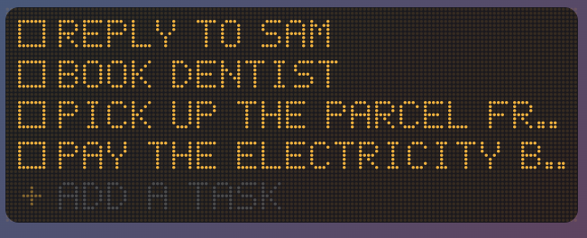
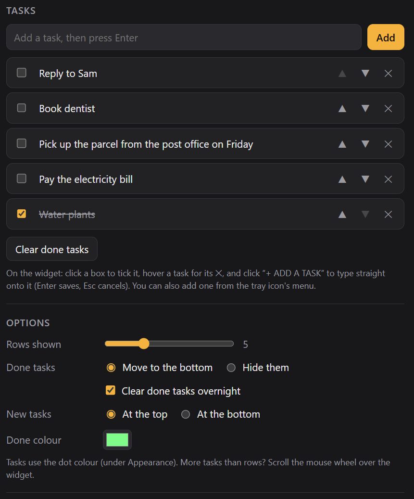

# Dot List

A dot-matrix to-do list for Windows and macOS. Type tasks straight onto the widget and click to tick them off.

## What it does

- **Tick:** click a box (or the task). It goes green and gets crossed through, then a moment later it moves to the bottom, or hides if you prefer. Click it again to untick.
- **Add:** click **+ ADD A TASK** and type straight onto the widget. Enter saves, Esc cancels, and pasting works. You can also add a task from the tray icon's menu, or in settings.
- **Remove:** hover over a task and click the red ✕.
- **Read long tasks:** hovering over one scrolls it so you can read the whole thing.
- **Long lists:** choose how many rows show (3–10). If there are more tasks than that, scroll the mouse wheel. A thin bar on the right shows where you are.
- **Settings also include:**
  - editing, reordering and removing tasks
  - **Clear done tasks**, and an option to clear done tasks overnight
  - whether new tasks go at the top or the bottom
  - the done colour
  - Match Dot Clock (same width, dot size and colours)

Everything stays on your computer. Dot List works fully offline.

## Where it lives

The widget doesn't take up a spot on the taskbar (or the Dock on a Mac). It sits in the **system tray** (the menu bar on a Mac) instead. Left-click the tray icon to bring the widget forward, and right-click it to add a task, show or hide the widget, open settings, move the widget to the centre of the screen, or quit.

## Building it yourself

See [BUILDING.md](BUILDING.md). The installer is called `Dot List_1.0.0_x64_en-US.msi`.

